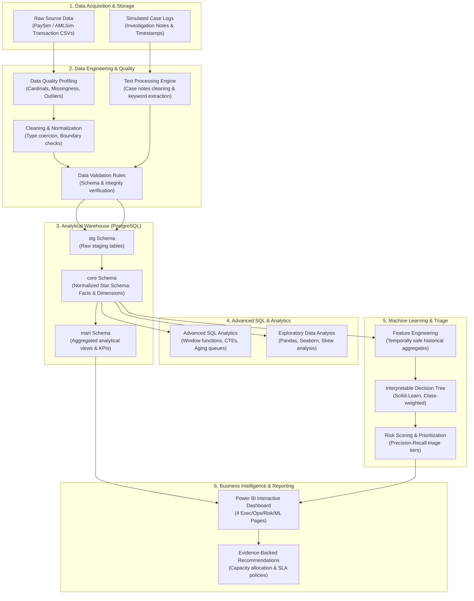

# System Architecture & Technical Design

## 1. End-to-End Pipeline Overview

The platform implements a production-grade analytics lifecycle tailored for financial services environments:

---

## 2. Architectural Layers

### Layer 1: Ingestion & Storage
- **Location**: `data/raw/`
- **Role**: Preserves pristine, immutable raw transaction datasets and simulator output.
- **Rule**: Never modified in-place; all processes consume raw data as read-only.

### Layer 2: Profiling, Cleaning, & Text Processing
- **Location**: `src/financial_risk/profiling.py`, `cleaning.py`, `text_processing.py`, `validation.py`
- **Role**:
  - Detects anomalies, negative values, and inconsistent account representations.
  - Cleans unstructured operational investigation notes (whitespace, tokens, issue flags).
  - Enforces strict assertions before database ingestion.

### Layer 3: Relational Analytical Warehouse (PostgreSQL)
- **Database**: `financial_risk_analytics`
- **Schemas**:
  - `stg`: Mirrored tables holding cleansed source extracts.
  - `core`: Dimensional star schema (`fact_transactions`, `fact_investigations`, `dim_account`, `dim_transaction_type`, `dim_date`, `dim_case_status`).
  - `mart`: Analytical summary views optimized for fast BI dashboard queries.

### Layer 4: Advanced SQL & Business Logic
- **Location**: `sql/`
- **Role**: Demonstrates enterprise SQL capabilities:
  - Multi-table analytical joins, CTEs, and conditional aggregations.
  - Window functions (`ROW_NUMBER()`, `LAG()`, `LEAD()`, `RANK()`, rolling averages, running balances).
  - Investigation aging buckets (`<24h`, `24-72h`, `>72h`), SLA breach detection, and backlog tracking.

### Layer 5: Interpretable Machine Learning & Prioritization
- **Location**: `src/financial_risk/modeling.py`, `risk_scoring.py`
- **Role**:
  - Constructs temporally safe features (no lookahead / data leakage).
  - Trains a shallow, inspectable Decision Tree classifier.
  - Generates transparent if-then decision paths aligned with regulatory audit requirements.
  - Maps predicted probabilities to actionable review queues (High, Medium, Low Priority).

### Layer 6: Business Intelligence (Power BI)
- **Location**: `dashboard/`
- **Pages**:
  1. *Executive Overview*: High-level portfolio KPIs, risk exposure, and flagged volume.
  2. *Transaction Risk Intelligence*: Concentration curves, channel risk, and hourly heatmaps.
  3. *Investigation Operations*: Backlog aging, investigator capacity, and SLA tracking.
  4. *Predictive Analytics & Model Governance*: Confusion matrix, threshold curves, and feature importance.
