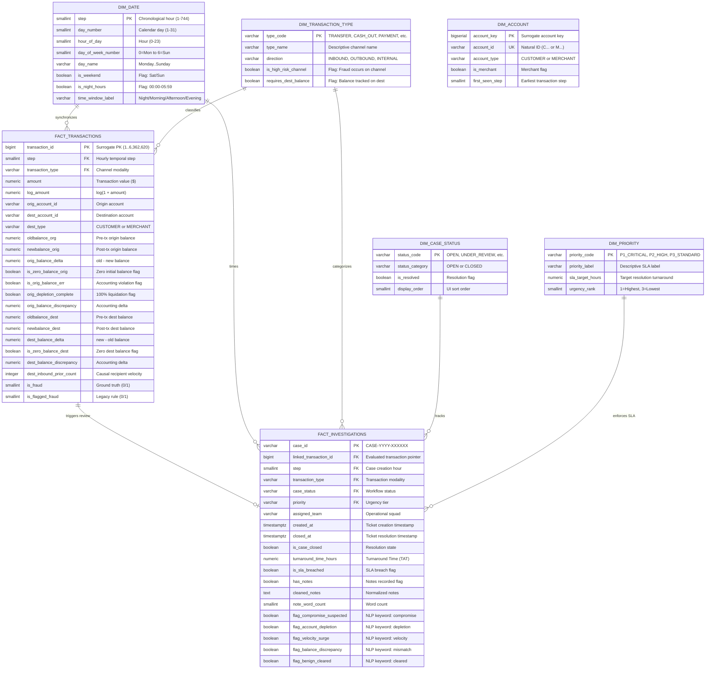

# Relational Analytical Data Model & Entity-Relationship (ER) Architecture

## 1. Enterprise Star Schema Architecture

The relational warehouse for the **Financial Transaction Risk & Operations Intelligence Platform** is hosted in PostgreSQL (`financial_risk_analytics`). It implements a 3-tier warehouse pattern:
1. **Staging Schema (`stg`)**: 1:1 tabular landing zone for cleaned transaction streams and operational case records.
2. **Core Dimensional Schema (`core`)**: High-performance Star Schema separating business dimensions from high-volume transaction and investigation facts.
3. **Data Mart Schema (`mart`)**: Aggregated analytical views optimized for DirectQuery and Import models in **Power BI**.

---

## 2. Mermaid Entity-Relationship (ER) Diagram

---

## 3. Schema Catalog & Entity Specifications

### A. `core.fact_transactions`
- **Business Meaning**: Represents the fundamental financial fact event (an individual monetary transfer or liquidation request).
- **Grain**: 1 row = 1 executed financial transaction.
- **Primary Key**: `transaction_id` (`BIGINT`, range `1` to `6,362,620`).
- **Foreign Keys**:
  - `step` $\rightarrow$ `core.dim_date(step)`
  - `transaction_type` $\rightarrow$ `core.dim_transaction_type(type_code)`
- **Indexing Strategy**:
  - `idx_fact_tx_step`: Optimizes temporal sliding windows and time-series queries.
  - `idx_fact_tx_type`: Accelerates channel filtering (`TRANSFER` and `CASH_OUT`).
  - `idx_fact_tx_fraud`: Speeds up fraud exposure filtering and loss calculations.
  - `idx_fact_tx_orig` and `idx_fact_tx_dest`: Supports customer 360 lookup and entity velocity joins.
  - `idx_fact_tx_composite_risk`: Composite index `(transaction_type, is_fraud, amount)` for sub-second dashboard aggregation.

---

### B. `core.fact_investigations`
- **Business Meaning**: Represents the operational human investigation ticket initiated when an alert rule triggers.
- **Grain**: 1 row = 1 operational case investigation ticket (5,000 cases).
- **Primary Key**: `case_id` (`VARCHAR(32)`).
- **Foreign Keys**:
  - `linked_transaction_id` $\rightarrow$ `core.fact_transactions(transaction_id)`
  - `step` $\rightarrow$ `core.dim_date(step)`
  - `transaction_type` $\rightarrow$ `core.dim_transaction_type(type_code)`
  - `case_status` $\rightarrow$ `core.dim_case_status(status_code)`
  - `priority` $\rightarrow$ `core.dim_priority(priority_code)`
- **Indexing Strategy**:
  - `idx_fact_inv_linked_tx`: Enables rapid 1:1 and 1:N joins between case queues and underlying ledger transactions.
  - `idx_fact_inv_status` and `idx_fact_inv_priority`: Optimizes operations backlog views.
  - `idx_fact_inv_sla`: Filters operational SLA breaches for risk leadership audits.

---

### C. Conformed Dimension Tables
1. **`core.dim_date`**: 744 rows covering steps 1 to 744 (31 calendar days). Provides attributes for diurnal cycles, day of week, weekend flags, and temporal day grouping.
2. **`core.dim_transaction_type`**: 5 rows (`TRANSFER`, `CASH_OUT`, `PAYMENT`, `CASH_IN`, `DEBIT`). Identifies flow direction and flags high-risk fraud rails.
3. **`core.dim_case_status`**: 4 rows (`OPEN`, `UNDER_REVIEW`, `CLOSED_CONFIRMED_FRAUD`, `CLOSED_FALSE_POSITIVE`). Categorizes tickets into open backlog vs resolved states.
4. **`core.dim_priority`**: 3 rows (`P1_CRITICAL`, `P2_HIGH`, `P3_STANDARD`). Governs SLA target hours (24h, 48h, 96h).
5. **`core.dim_account`**: Unique registry of customer and merchant identifiers.

---

## 4. Analytical Data Marts (`mart` Schema Views)

To decouple business reporting queries from the massive transaction fact table, we defined three pre-aggregated views:

1. **`mart.mart_risk_executive_overview`**:
   - Aggregates by `day_number`, `day_name`, and `transaction_type`.
   - Metrics: Gross Transaction Value (GTV), total transaction volume, fraud count, fraud exposure value, fraud prevalence %, and mean ticket size.
   - Purpose: Direct feed for **Page 1 (Executive Overview)** of the Power BI dashboard.
2. **`mart.mart_investigation_operations`**:
   - Aggregates by `assigned_team`, `priority_code`, and `case_status`.
   - Metrics: Total tickets, open backlog, closed tickets, SLA breach count, SLA breach rate %, median/mean turnaround time (TAT), and keyword flags.
   - Purpose: Direct feed for **Page 3 (Investigation Operations)** of the Power BI dashboard.
3. **`mart.mart_channel_exposure`**:
   - Modality risk concentration metrics comparing total transaction volume against fraud value concentration.
   - Purpose: Direct feed for **Page 2 (Transaction Risk Intelligence)**.

---

## 5. Architectural Distinctions: Genuine Source vs Synthetic Case Data

- **Transaction Records**: Derived from the benchmark PaySim multi-agent simulation model, representing ledger accounting events.
- **Investigation Records**: Generated as an explicit operational simulation to model ticket workflows, SLA monitoring, and text processing.
- **Integrity Boundary**: The foreign key `linked_transaction_id` maps cleanly to `transaction_id`. Operational features exist solely in `fact_investigations` and are strictly excluded from the pre-transaction feature matrix.
